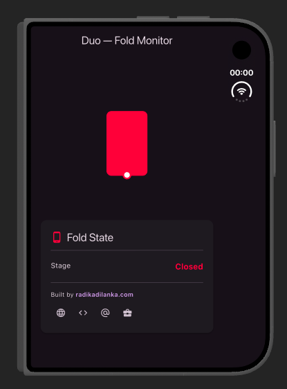
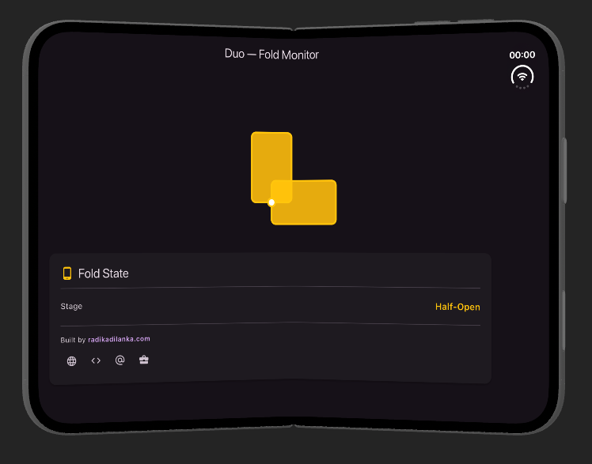
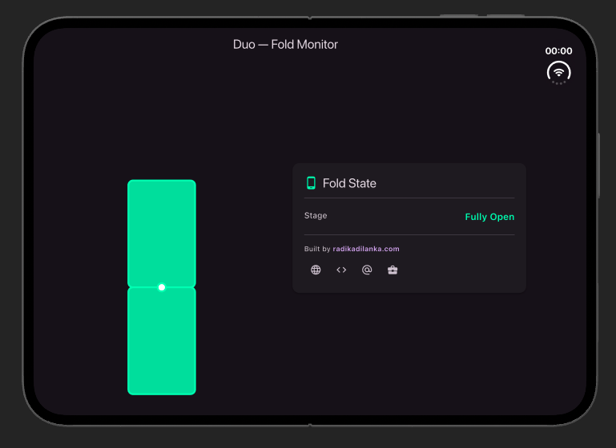
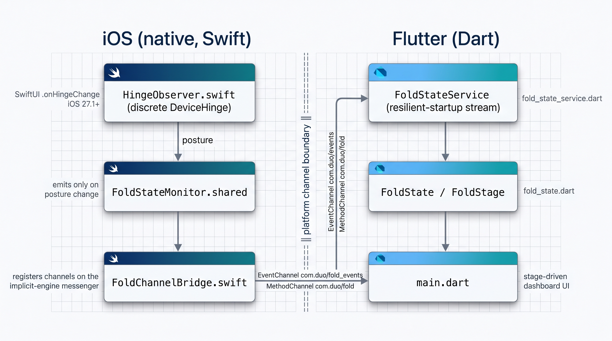

# iPhone Duo - Fold Monitor (Flutter)


**A Flutter app template** for detecting iPhone Duo fold stages. Use it as a
starting point to build your own app, or take the idea and drop it into an
existing Flutter app to respond to the closed, half-open, and fully-open stages
in a cleaner way. 

##

Detect **foldable device posture** in Flutter on iOS, driven by the real,
event-driven system hinge API — not by guessing from accelerometer angles.

`duo` bridges iOS's discrete hinge posture signal (`DeviceHinge.status`,
delivered via SwiftUI's `onHingeChange`, iOS 27.1+) into Flutter over platform
channels, and ships a small adaptive UI whose fold illustration and color
reflect the current posture.

> Platform support: **iOS only.** This repo does not include an Android
> project.

## Screenshots

| Closed | Half-Open | Fully Open |
| :----: | :-------: | :--------: |
|  |  |  |

## Features

- **Event-driven posture**: reports `closed`, `half-open`, and `fully-open`
  directly from the OS posture status. No continuous-angle bucketing, no
  self-animating loops. The native side emits **only when the posture actually
  changes**, not on a timer.
- **MethodChannel + EventChannel bridge**: subscribe to a stream of
  posture-change events, or pull the last known snapshot on demand.
- **Supplementary data**: the OS-reported hinge angle travels alongside the
  posture in the payload. The stage is authoritative; the angle is
  informational only.
- **Resilient startup**: the Dart stream waits out the implicit-engine
  registration race instead of dying on a one-shot `MissingPluginException`.
- **Stage-driven UI**: the hinge illustration opens to a fixed pose per stage
  (closed → red, half-open → yellow, fully-open → green) and the layout stacks
  when folded / sits side-by-side when fully open.
- **Graceful degradation**: on pre-iOS-27.1 systems (or non-foldables) the
  posture reads `unknown` rather than reporting a fake value.

## Posture states

| Dart `FoldStage` | Channel value | Label        | Meaning                                   |
| ---------------- | ------------- | ------------ | ----------------------------------------- |
| `closed`         | `closed`      | `Closed`     | Device shut (outer display)               |
| `halfOpen`       | `half_open`   | `Half-Open`  | Hinge partially open / half-folded        |
| `fullyOpen`      | `fully_open`  | `Fully Open` | Laid flat as one continuous inner display |
| `unknown`        | `unknown`     | `Unknown`    | No hinge info (not foldable / unsupported)|

## Platform channels

Both channels are registered on the implicit engine's binary messenger and
share the same posture source.

| Channel                | Type            | Purpose                                    |
| ---------------------- | --------------- | ------------------------------------------ |
| `com.duo/fold_events`  | `EventChannel`  | Stream of posture-change events (primary)  |
| `com.duo/fold`         | `MethodChannel` | `getCurrentState`, `startMonitoring`, `stopMonitoring`; also receives an `onFoldStateChanged` callback |

Event payload (a map):

```jsonc
{
  "stage":      "half_open",   // closed | half_open | fully_open | unknown
  "hingeAngle": 92.0,          // OS-reported degrees (supplementary)
  "timestamp":  1700000000000  // ms since epoch
}
```

## Architecture



### Key files

- `ios/Runner/HingeObserver.swift` — SwiftUI observer using `onHingeChange`,
  hosted invisibly in the Flutter view hierarchy (required for the OS to
  deliver hinge events). Gated behind `#if canImport(SwiftUI, _version: 8.0.85)`
  and `@available(iOS 27.1, *)`.
- `ios/Runner/FoldStateMonitor.swift` — event sink; caches the last state and
  emits a `FoldState` only when the stage changes.
- `ios/Runner/FoldChannelBridge.swift` — registers the `MethodChannel` and
  `EventChannel` on the implicit engine's binary messenger.
- `ios/Runner/SceneDelegate.swift` — installs the hinge observer once the scene
  connects.
- `ios/Runner/AppDelegate.swift` — registers the channel bridge in
  `didInitializeImplicitFlutterEngine`.
- `lib/fold_state.dart` — `FoldState` model and `FoldStage` enum.
- `lib/fold_state_service.dart` — Dart gateway over the two channels, with the
  resilient-startup stream.
- `lib/main.dart` — the stage-driven dashboard UI.

## Requirements

- Flutter 3.x (Dart SDK `^3.13.5`)
- Xcode 27.1+ (iOS 27.1 SDK) to build the hinge-observing path
- A foldable iOS device running iOS 27.1+ to receive live posture events
  (on the simulator / non-foldables the posture stays `unknown`)

## Dependencies

- [`url_launcher`](https://pub.dev/packages/url_launcher) — opens the author
  links shown in the UI.

## Getting started

```bash
flutter pub get
flutter run
```

If you change native code (Swift, `Info.plist`, channel names), do a full
`flutter run` — a hot restart does not re-register native plugins/handlers.

## Usage

```dart
import 'package:duo/fold_state_service.dart';

final service = FoldStateService();

// Subscribe to posture-change events.
service.stream.listen((state) {
  print('posture: ${state.stage.label}');  // Closed / Half-Open / Fully Open
  print('angle:   ${state.hingeAngle}');   // supplementary, OS-reported
});

// Or pull the last known snapshot once.
final current = await service.getCurrentState();
```

## Testing

```bash
flutter analyze       # static analysis
flutter test          # Dart unit + widget tests
```

The test suite covers payload parsing (`FoldState.fromMap`), the
resilient-startup retry past `MissingPluginException`, and that the UI renders
the stage carried by an event.

## About

`duo` was created to give Flutter developers a correct, event-driven way to
detect foldable posture on iOS. Contributions, issues, and ideas are welcome.

**Author:** Radika Dilanka

- Website: <https://radikadilanka.com>
- GitHub: <https://github.com/radika-insfra>
- X / Twitter: <https://x.com/radikadilanka>
- LinkedIn: <https://www.linkedin.com/in/radikadilanka>


## Contributing

1. Fork the repo and create a feature branch.
2. Run `flutter analyze` and `flutter test` before opening a PR.
3. Keep posture detection event-driven — avoid reintroducing angle-based
   bucketing or simulated animation as the source of truth.

## License

This project is licensed under the MIT License - see the [LICENSE](LICENSE) file for details.
